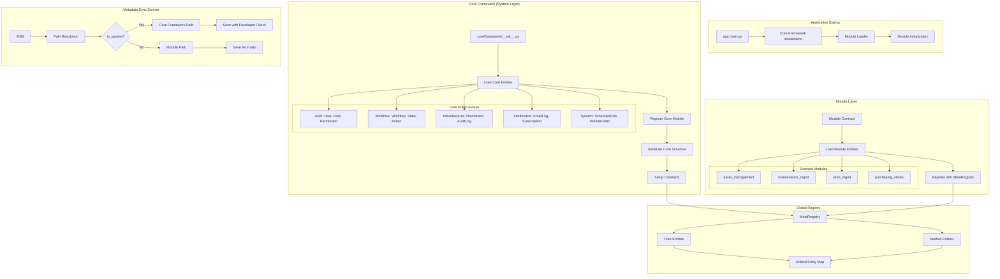

# Core Framework Entity Architecture Design

**Story:** 2. Design Core Framework Entity Architecture  
**Date:** 2026-04-06  
**Status:** Design Complete  
**Architecture:** Frappe-Inspired Multi-Root System

## Executive Summary

This design establishes a **Frappe-inspired multi-root architecture** that separates **Core Framework Entities** (System App) from **Module-Specific Entities** (Installable Apps). The Core Framework provides foundational infrastructure while maintaining **Developer-Only editing constraints** to protect system integrity.

---

## Architecture Decision Records (ADRs)

### ADR-001: Multi-Root Entity Discovery
**Status:** Accepted  
**Context:** Need to separate system entities from business entities while maintaining unified access.

**Decision:** Implement dual-root discovery pattern:
- **Root A:** `backend/app/core/framework/` (System Layer)
- **Root B:** `backend/app/modules/*/entities/` (Module Layer)

**Consequences:** 
- ✅ Clear separation of concerns
- ✅ Metadata Sync Service handles both roots
- ✅ Modules remain pluggable
- ❌ Increased complexity in entity discovery

### ADR-002: Developer-Only Core Entity Editing
**Status:** Accepted  
**Context:** Core entities must be protected from accidental modification by administrators.

**Decision:** Core entities marked with `is_system: true` require `DEVELOPER_MODE=1` to edit.

**Consequences:**
- ✅ System integrity protection
- ✅ Clear ownership boundaries
- ❌ Additional complexity in UI permissions

### ADR-003: JSON as Source of Truth
**Status:** Accepted  
**Context:** Dual storage problem between SQLAlchemy models and JSON metadata.

**Decision:** JSON metadata is primary source; SQLAlchemy models validated against JSON on startup.

**Consequences:**
- ✅ Single source of truth
- ✅ Metadata-driven development
- ❌ Validation overhead on startup

---

## Directory Structure Design

### Core Framework Structure

```
backend/app/core/framework/
├── __init__.py                  # Public API exports & initialization
├── models/                      # SQLAlchemy models (generated/validated)
│   ├── __init__.py             # Model exports
│   ├── auth.py                 # User, Role, EntityPermission
│   ├── workflow.py             # Workflow* models
│   ├── infrastructure.py       # Attachment, AuditLog, ErrorLog
│   ├── notification.py         # EmailLog, NotificationSubscription
│   └── system.py               # ScheduledJobLog, ModuleOrder, EntityOrder
├── entities/                    # JSON metadata (primary source)
│   ├── __init__.py             # Entity discovery
│   ├── auth.json               # Authentication entities
│   ├── workflow.json           # Workflow engine entities
│   ├── infrastructure.json     # Infrastructure entities
│   ├── notification.json       # Notification entities
│   └── system.json             # System entities
├── schemas/                     # Pydantic schemas
│   ├── __init__.py             # Schema exports
│   ├── auth.py                 # Auth schemas
│   ├── workflow.py             # Workflow schemas
│   ├── infrastructure.py       # Infrastructure schemas
│   ├── notification.py         # Notification schemas
│   └── system.py               # System schemas
└── contracts/                   # Framework contracts
    ├── __init__.py             # Contract exports
    ├── entity_contract.py      # Entity interface definition
    ├── module_contract.py      # Module interface definition
    └── initialization.py       # Initialization contract
```

### Module Structure (Existing Pattern)

```
backend/app/modules/{module_name}/
├── entities/                    # JSON metadata (module-specific)
│   ├── asset.json
│   ├── work_order.json
│   └── ...
├── models/                      # SQLAlchemy models
│   ├── asset.py
│   ├── work_order.py
│   └── ...
└── ...
```

---

## Entity Ownership Rules

### Core Framework Entities (System Layer)

**Criteria for Core Framework:**
1. **System Bootstrap:** Required for application startup
2. **Cross-Module Usage:** Used by 3+ modules
3. **Infrastructure Nature:** Logging, auth, workflow, notifications
4. **No Business Domain:** Generic system functionality

**Core Entity Groups:**

| Group | Entities | Purpose | `is_system` |
|-------|----------|---------|-------------|
| **Auth** | User, Role, EntityPermission | Authentication & Authorization | `true` |
| **Workflow** | Workflow, WorkflowState, WorkflowAction, WorkflowTransition, WorkflowStateLink | Workflow Engine | `true` |
| **Infrastructure** | Attachment, AuditLog, ErrorLog | System Infrastructure | `true` |
| **Notification** | EmailLog, NotificationSubscription | Communication System | `true` |
| **System** | ScheduledJobLog, ModuleOrder, EntityOrder | System Management | `true` |

### Module Entities (Business Layer)

**Criteria for Module Entities:**
1. **Business Domain:** Specific to EAM, maintenance, purchasing, etc.
2. **Optional Installation:** Can be enabled/disabled per installation
3. **Business Logic:** Contains industry-specific rules
4. **Extensible:** May be customized per implementation

**Module Entity Examples:**
- **EAM Core:** Organization, Site, Department, Employee, Asset
- **Asset Management:** AssetClass, Location, System
- **Maintenance:** MaintenanceRequest, MaintenanceOrder
- **Work Management:** WorkOrder, WorkOrderActivity
- **Purchasing:** PurchaseRequest, PurchaseOrder, Item

---

## Initialization Contract

### Core Framework Initialization

```python
# backend/app/core/framework/__init__.py
"""
Core Framework - Foundation Entities
==================================
Auto-available to all modules without explicit imports.

Provides:
- Authentication: User, Role, EntityPermission
- Workflow: Workflow, WorkflowState, WorkflowAction, WorkflowTransition, WorkflowStateLink
- Infrastructure: Attachment, AuditLog, ErrorLog
- Notification: EmailLog, NotificationSubscription
- System: ScheduledJobLog, ModuleOrder, EntityOrder
"""

import logging
from typing import Dict, Any, List
from pathlib import Path

logger = logging.getLogger(__name__)

# Core framework state
_framework_initialized: bool = False
_entity_registry: Dict[str, Any] = {}
_model_registry: Dict[str, Any] = {}
_schema_registry: Dict[str, Any] = {}

def initialize_core_framework() -> None:
    """Initialize core framework entities and contracts.
    
    This function is called automatically during application startup.
    Modules should NOT call this directly.
    """
    global _framework_initialized, _entity_registry, _model_registry, _schema_registry
    
    if _framework_initialized:
        logger.debug("Core framework already initialized")
        return
    
    logger.info("Initializing Core Framework...")
    
    # 1. Load core entities from JSON metadata
    _load_core_entities()
    
    # 2. Validate and register SQLAlchemy models
    _register_core_models()
    
    # 3. Generate and register Pydantic schemas
    _register_core_schemas()
    
    # 4. Setup framework contracts
    _setup_contracts()
    
    _framework_initialized = True
    logger.info("Core Framework initialization complete")

def _load_core_entities() -> None:
    """Load core entity metadata from JSON files."""
    from app.meta.registry import EntityMeta
    from app.entities import load_entity_from_json
    
    entities_dir = Path(__file__).parent / "entities"
    
    for json_file in entities_dir.glob("*.json"):
        entity_name = json_file.stem
        try:
            entity_meta = load_entity_from_json(json_file)
            entity_meta.is_system = True  # Mark as system entity
            _entity_registry[entity_name] = entity_meta
            logger.debug(f"Loaded core entity: {entity_name}")
        except Exception as e:
            logger.error(f"Failed to load core entity {entity_name}: {e}")

def _register_core_models() -> None:
    """Register SQLAlchemy models from core framework."""
    from app.models import register_model
    
    # Import all core models to register them with SQLAlchemy
    from .models.auth import User, Role, EntityPermission
    from .models.workflow import Workflow, WorkflowState, WorkflowAction, WorkflowTransition, WorkflowStateLink
    from .models.infrastructure import Attachment, AuditLog, ErrorLog
    from .models.notification import EmailLog, NotificationSubscription
    from .models.system import ScheduledJobLog, ModuleOrder, EntityOrder
    
    # Register models in entity repository
    core_models = {
        'user': User, 'role': Role, 'entity_permission': EntityPermission,
        'workflow': Workflow, 'workflow_state': WorkflowState, 'workflow_action': WorkflowAction,
        'workflow_transition': WorkflowTransition, 'workflow_state_link': WorkflowStateLink,
        'attachment': Attachment, 'audit_log': AuditLog, 'error_log': ErrorLog,
        'email_log': EmailLog, 'notification_subscription': NotificationSubscription,
        'scheduled_job_log': ScheduledJobLog, 'module_order': ModuleOrder, 'entity_order': EntityOrder
    }
    
    for entity_name, model_class in core_models.items():
        register_model(entity_name, model_class)
        _model_registry[entity_name] = model_class

def _register_core_schemas() -> None:
    """Generate and register Pydantic schemas for core entities."""
    from app.core.framework.schemas import generate_schemas_for_entities
    
    _schema_registry = generate_schemas_for_entities(_entity_registry)

def _setup_contracts() -> None:
    """Setup framework contracts for module integration."""
    from .contracts.entity_contract import EntityContract
    from .contracts.module_contract import ModuleContract
    from .contracts.initialization import InitializationContract
    
    # Register contracts globally
    EntityContract.register_core_entities(_entity_registry)
    ModuleContract.register_framework_contracts()
    InitializationContract.set_initialized()

# Public API
def get_core_entity(entity_name: str) -> Any:
    """Get core entity metadata by name."""
    if not _framework_initialized:
        initialize_core_framework()
    return _entity_registry.get(entity_name)

def get_core_model(entity_name: str) -> Any:
    """Get core SQLAlchemy model by name."""
    if not _framework_initialized:
        initialize_core_framework()
    return _model_registry.get(entity_name)

def get_core_schema(entity_name: str) -> Any:
    """Get core Pydantic schema by name."""
    if not _framework_initialized:
        initialize_core_framework()
    return _schema_registry.get(entity_name)

def list_core_entities() -> List[str]:
    """List all core entity names."""
    if not _framework_initialized:
        initialize_core_framework()
    return list(_entity_registry.keys())

# Model exports for backward compatibility
from .models.auth import User, Role, EntityPermission
from .models.workflow import Workflow, WorkflowState, WorkflowAction, WorkflowTransition, WorkflowStateLink
from .models.infrastructure import Attachment, AuditLog, ErrorLog
from .models.notification import EmailLog, NotificationSubscription
from .models.system import ScheduledJobLog, ModuleOrder, EntityOrder

# Schema exports
from .schemas.auth import UserSchema, RoleSchema, EntityPermissionSchema
from .schemas.workflow import WorkflowSchema, WorkflowStateSchema, WorkflowActionSchema
from .schemas.infrastructure import AttachmentSchema, AuditLogSchema, ErrorLogSchema
from .schemas.notification import EmailLogSchema, NotificationSubscriptionSchema
from .schemas.system import ScheduledJobLogSchema, ModuleOrderSchema, EntityOrderSchema

__all__ = [
    # Framework functions
    "initialize_core_framework", "get_core_entity", "get_core_model", 
    "get_core_schema", "list_core_entities",
    
    # Models
    "User", "Role", "EntityPermission",
    "Workflow", "WorkflowState", "WorkflowAction", "WorkflowTransition", "WorkflowStateLink",
    "Attachment", "AuditLog", "ErrorLog",
    "EmailLog", "NotificationSubscription", 
    "ScheduledJobLog", "ModuleOrder", "EntityOrder",
    
    # Schemas
    "UserSchema", "RoleSchema", "EntityPermissionSchema",
    "WorkflowSchema", "WorkflowStateSchema", "WorkflowActionSchema",
    "AttachmentSchema", "AuditLogSchema", "ErrorLogSchema",
    "EmailLogSchema", "NotificationSubscriptionSchema",
    "ScheduledJobLogSchema", "ModuleOrderSchema", "EntityOrderSchema",
]
```

### Module Initialization Contract

```python
# backend/app/core/framework/contracts/module_contract.py
"""
Module Contract - Defines how modules interact with Core Framework
"""
from abc import ABC, abstractmethod
from typing import Dict, Any, List, Optional

class ModuleContract(ABC):
    """Contract that all modules must follow for Core Framework integration."""
    
    @staticmethod
    def initialize_module(module_name: str, module_path: str) -> None:
        """Initialize a module with Core Framework integration.
        
        Args:
            module_name: Name of the module (e.g., 'asset_management')
            module_path: Path to module directory
            
        This function is called by the module loader during application startup.
        """
        from app.core.framework import initialize_core_framework
        from app.meta.registry import MetaRegistry
        
        # Ensure core framework is initialized first
        initialize_core_framework()
        
        # Load module entities
        module_entities = ModuleContract._load_module_entities(module_path)
        
        # Register with global registry
        registry = MetaRegistry.get_instance()
        for entity_name, entity_meta in module_entities.items():
            entity_meta.is_system = False  # Mark as module entity
            registry.register_entity(entity_name, entity_meta)
    
    @staticmethod
    def _load_module_entities(module_path: str) -> Dict[str, Any]:
        """Load entity metadata from module's entities directory."""
        from pathlib import Path
        from app.entities import load_entity_from_json
        
        entities = {}
        entities_dir = Path(module_path) / "entities"
        
        if not entities_dir.exists():
            return entities
        
        for json_file in entities_dir.glob("*.json"):
            entity_name = json_file.stem
            try:
                entity_meta = load_entity_from_json(json_file)
                entities[entity_name] = entity_meta
            except Exception as e:
                import logging
                logger = logging.getLogger(__name__)
                logger.error(f"Failed to load module entity {entity_name}: {e}")
        
        return entities
    
    @staticmethod
    def get_core_entity(entity_name: str) -> Optional[Any]:
        """Get a core entity by name.
        
        Modules should use this method to access core entities
        rather than importing them directly.
        """
        from app.core.framework import get_core_entity
        return get_core_entity(entity_name)
    
    @staticmethod
    def list_core_entities() -> List[str]:
        """List all available core entities."""
        from app.core.framework import list_core_entities
        return list_core_entities()
    
    @staticmethod
    def register_framework_contracts() -> None:
        """Register framework contracts for module use."""
        # This is called during core framework initialization
        pass
```

---

## Export Patterns

### Public API Exports

Core Framework provides a **stable public API** that modules can rely on:

```python
# Modules can import core entities through the public API
from app.core.framework import (
    User, Role, EntityPermission,           # Auth entities
    Workflow, WorkflowState, WorkflowAction, # Workflow entities
    Attachment, AuditLog, ErrorLog,         # Infrastructure entities
    get_core_entity, list_core_entities    # Utility functions
)
```

### Restricted Internal Exports

Internal implementation details are **not exported**:

```python
# These are NOT in __all__ and should not be imported by modules
from app.core.framework._internal import (
    _load_core_entities,      # Internal loading logic
    _register_core_models,     # Internal registration
    _setup_contracts          # Internal contract setup
)
```

### Metadata-Driven Exports

Schemas and utility classes are **generated dynamically** from metadata:

```python
# Schemas are generated from JSON metadata
from app.core.framework.schemas import (
    UserSchema,        # Generated from auth.json
    WorkflowSchema,    # Generated from workflow.json
    AttachmentSchema   # Generated from infrastructure.json
)
```

---

## Metadata Sync Service Integration

### Path Resolution Logic

```python
# backend/app/infrastructure/metadata/metadata_sync_service.py
class MetadataSyncService:
    """Enhanced MSS with multi-root support."""
    
    def _resolve_entity_path(self, entity_meta: EntityMeta) -> Path:
        """Resolve the correct path based on entity type."""
        if getattr(entity_meta, 'is_system', False):
            # Core framework entity
            return Path(__file__).parent.parent.parent / "core" / "framework" / "entities" / f"{entity_meta.name}.json"
        else:
            # Module entity
            module_name = self._get_module_for_entity(entity_meta.name)
            return Path(__file__).parent.parent.parent / "modules" / module_name / "entities" / f"{entity_meta.name}.json"
    
    def save_and_sync(self, entity_meta: EntityMeta, user_context: dict) -> dict:
        """Save entity with developer-mode protection for core entities."""
        # Developer mode check for system entities
        if getattr(entity_meta, 'is_system', False) and not settings.DEVELOPER_MODE:
            raise PermissionError("Core Framework entities can only be edited in Developer Mode.")
        
        # Continue with normal sync process...
        return super().save_and_sync(entity_meta, user_context)
```

---

## Architecture Diagram



---

## Implementation Timeline

### Phase 1: Foundation (2 days)
- [ ] Create `backend/app/core/framework/` directory structure
- [ ] Implement core framework initialization
- [ ] Create module contract
- [ ] Update Metadata Sync Service path resolution

### Phase 2: Entity Migration (5 days)
- [ ] Migrate Auth entities to core framework
- [ ] Migrate Workflow entities to core framework
- [ ] Migrate Infrastructure entities to core framework
- [ ] Automated refactoring of import paths
- [ ] Update entity repository registration

### Phase 3: Developer Mode Protection (3 days)
- [ ] Implement `is_system` flag in entity metadata
- [ ] Add developer mode checks to Model Editor
- [ ] Update API endpoints with developer mode validation
- [ ] Add deprecation warnings for old import paths

### Phase 4: Integration & Testing (4 days)
- [ ] Update module loader to use new contracts
- [ ] Comprehensive testing of dual-root discovery
- [ ] Performance testing of initialization
- [ ] Documentation updates

---

## Success Criteria

- [ ] **Directory Structure**: `backend/app/core/framework/{entities,schemas,models}` created and populated
- [ ] **Entity Ownership**: Clear rules documented and implemented for core vs module entities
- [ ] **Initialization Contract**: Modules automatically get core entity access without explicit imports
- [ ] **Export Patterns**: Stable public API defined with proper encapsulation
- [ ] **Architecture Documentation**: ADRs, diagrams, and decision records completed

---

## Next Steps

1. **Review and approve** this architecture design
2. **Begin Story 3**: Consolidate User & Role Core Entities
3. **Implement** the phased migration plan
4. **Update** related documentation and tests

---

**Design Created By:** Story 2 Architecture Process  
**Aligned With:** Finalized Audit Report (Frappe-inspired multi-root architecture)  
**Ready for Story 3:** Entity consolidation implementation
